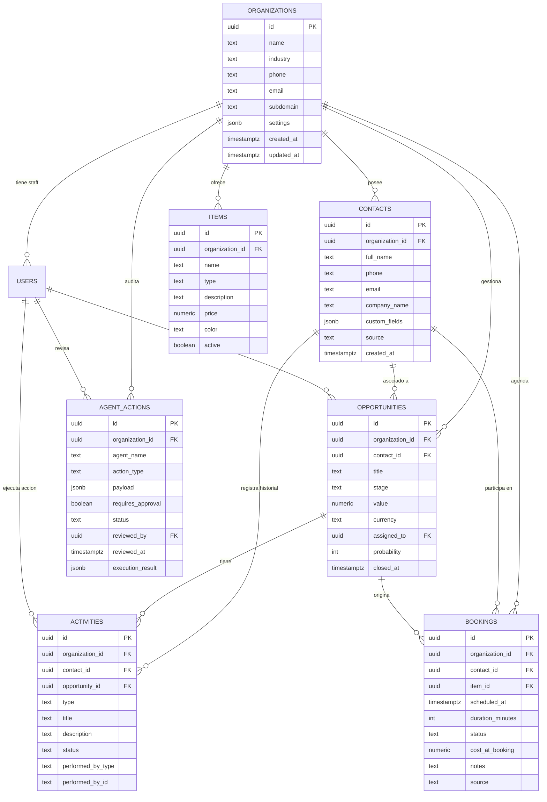

# Especificacion Tecnica — Fase 0: Schema Universal y Base de Datos v2

Documento de diseno y ejecucion para agentes y desarrolladores.
Objetivo: Actualizar la base de datos en Supabase, definir la arquitectura relacional universal, establecer aislamiento multi-tenant y garantizar compatibilidad retroactiva con la version 1.

---

## 1. Contexto y Objetivos

En la version 1 de Ravyn CRM, las tablas estaban acopladas exclusivamente a clinicas dentales (`clinics`, `patients`, `appointments`, `services`, `budgets`).
En la version 2, la plataforma pasa a ser un CRM multi-agente para cualquier tipo de negocio (salud, restaurantes, inmobiliarias, servicios profesionales, retail).

### Objetivos Especificos de la Fase 0
1. Desplegar el nuevo esquema DDL en Supabase con soporte para multiples verticales de negocio.
2. Crear la infraestructura relacional para el registro y gobernanza de agentes de IA (`agent_actions`, `agent_logs`).
3. Mantener compatibilidad absoluta o migracion transparente de los datos de la v1 sin romper la aplicacion actual.
4. Definir las politicas de seguridad RLS e indices de rendimiento por tenant (`organization_id`).
5. Generar los tipos TypeScript de base de datos actualizados.

---

## 2. Diagrama Entidad-Relacion (ERD)



---

## 3. Esquema DDL SQL para Supabase (PostgreSQL)

El siguiente script SQL debe ejecutarse en el servidor Supabase. Se han incluido extensiones, triggers de actualizacion, indices y politicas de seguridad RLS.

```sql
-- Habilitar extension pgcrypto si no estuviera activa
CREATE EXTENSION IF NOT EXISTS "pgcrypto";

-- Funcion utilitaria para actualizar timestamp
CREATE OR REPLACE FUNCTION update_updated_at_column()
RETURNS TRIGGER AS $$
BEGIN
  NEW.updated_at = now();
  RETURN NEW;
END;
$$ LANGUAGE plpgsql;

-- 1. ORGANIZATIONS (Tenant principal)
CREATE TABLE IF NOT EXISTS public.organizations (
  id uuid PRIMARY KEY DEFAULT gen_random_uuid(),
  name text NOT NULL,
  industry text NOT NULL CHECK (industry IN ('health', 'restaurant', 'real_estate', 'professional_services', 'retail', 'general')),
  phone text,
  email text,
  subdomain text UNIQUE,
  plan text DEFAULT 'standard' CHECK (plan IN ('starter', 'standard', 'enterprise')),
  settings jsonb NOT NULL DEFAULT '{
    "active_modules": ["contacts", "bookings", "pipeline", "activities"],
    "business_hours": {"start": "09:00", "end": "18:00", "days": [1,2,3,4,5]},
    "agent_autonomy": "balanced"
  }'::jsonb,
  created_at timestamptz NOT NULL DEFAULT now(),
  updated_at timestamptz NOT NULL DEFAULT now()
);

CREATE TRIGGER update_organizations_updated_at
  BEFORE UPDATE ON public.organizations
  FOR EACH ROW EXECUTE FUNCTION update_updated_at_column();

-- 2. Modificacion o vinculo en USERS
-- Si la tabla users ya existe con clinic_id, se agrega organization_id nullable y luego foreign key
ALTER TABLE public.users 
  ADD COLUMN IF NOT EXISTS organization_id uuid REFERENCES public.organizations(id) ON DELETE CASCADE;

CREATE INDEX IF NOT EXISTS idx_users_organization_id ON public.users(organization_id);

-- 3. CONTACTS (Evolucion de patients)
CREATE TABLE IF NOT EXISTS public.contacts (
  id uuid PRIMARY KEY DEFAULT gen_random_uuid(),
  organization_id uuid NOT NULL REFERENCES public.organizations(id) ON DELETE CASCADE,
  full_name text NOT NULL,
  phone text,
  email text,
  company_name text,
  tags text[] DEFAULT ARRAY[]::text[],
  custom_fields jsonb NOT NULL DEFAULT '{}'::jsonb,
  source text NOT NULL DEFAULT 'manual' CHECK (source IN ('whatsapp', 'web', 'manual', 'agent_receptionist', 'import')),
  notes text,
  created_at timestamptz NOT NULL DEFAULT now(),
  updated_at timestamptz NOT NULL DEFAULT now()
);

CREATE INDEX IF NOT EXISTS idx_contacts_org_id ON public.contacts(organization_id);
CREATE INDEX IF NOT EXISTS idx_contacts_phone ON public.contacts(organization_id, phone);
CREATE INDEX IF NOT EXISTS idx_contacts_email ON public.contacts(organization_id, email);

CREATE TRIGGER update_contacts_updated_at
  BEFORE UPDATE ON public.contacts
  FOR EACH ROW EXECUTE FUNCTION update_updated_at_column();

-- 4. ITEMS (Catálogo universal de productos y servicios)
CREATE TABLE IF NOT EXISTS public.items (
  id uuid PRIMARY KEY DEFAULT gen_random_uuid(),
  organization_id uuid NOT NULL REFERENCES public.organizations(id) ON DELETE CASCADE,
  name text NOT NULL,
  type text NOT NULL DEFAULT 'service' CHECK (type IN ('service', 'product', 'experience')),
  description text,
  price numeric(12,2) NOT NULL DEFAULT 0.00,
  color text NOT NULL DEFAULT '#6366f1',
  active boolean NOT NULL DEFAULT true,
  metadata jsonb DEFAULT '{}'::jsonb,
  created_at timestamptz NOT NULL DEFAULT now(),
  updated_at timestamptz NOT NULL DEFAULT now()
);

CREATE INDEX IF NOT EXISTS idx_items_org_active ON public.items(organization_id, active);

CREATE TRIGGER update_items_updated_at
  BEFORE UPDATE ON public.items
  FOR EACH ROW EXECUTE FUNCTION update_updated_at_column();

-- 5. OPPORTUNITIES (Pipeline de ventas / Embudos)
CREATE TABLE IF NOT EXISTS public.opportunities (
  id uuid PRIMARY KEY DEFAULT gen_random_uuid(),
  organization_id uuid NOT NULL REFERENCES public.organizations(id) ON DELETE CASCADE,
  contact_id uuid REFERENCES public.contacts(id) ON DELETE SET NULL,
  title text NOT NULL,
  stage text NOT NULL CHECK (stage IN ('lead', 'contacted', 'qualified', 'proposal', 'negotiation', 'won', 'lost')),
  value numeric(12,2) NOT NULL DEFAULT 0.00,
  currency text NOT NULL DEFAULT 'MXN',
  probability int NOT NULL DEFAULT 0 CHECK (probability BETWEEN 0 AND 100),
  assigned_to uuid REFERENCES public.users(id) ON DELETE SET NULL,
  expected_close_date date,
  closed_at timestamptz,
  notes text,
  created_at timestamptz NOT NULL DEFAULT now(),
  updated_at timestamptz NOT NULL DEFAULT now()
);

CREATE INDEX IF NOT EXISTS idx_opportunities_org_stage ON public.opportunities(organization_id, stage);
CREATE INDEX IF NOT EXISTS idx_opportunities_contact ON public.opportunities(contact_id);

CREATE TRIGGER update_opportunities_updated_at
  BEFORE UPDATE ON public.opportunities
  FOR EACH ROW EXECUTE FUNCTION update_updated_at_column();

-- 6. BOOKINGS (Generalizacion de appointments para cualquier vertical)
CREATE TABLE IF NOT EXISTS public.bookings (
  id uuid PRIMARY KEY DEFAULT gen_random_uuid(),
  organization_id uuid NOT NULL REFERENCES public.organizations(id) ON DELETE CASCADE,
  contact_id uuid REFERENCES public.contacts(id) ON DELETE SET NULL,
  item_id uuid REFERENCES public.items(id) ON DELETE SET NULL,
  scheduled_at timestamptz NOT NULL,
  duration_minutes int NOT NULL DEFAULT 30,
  status text NOT NULL DEFAULT 'pending' CHECK (status IN ('pending', 'confirmed', 'cancelled', 'completed', 'no_show')),
  service_snapshot text,
  cost_at_booking numeric(12,2),
  notes text,
  source text NOT NULL DEFAULT 'manual' CHECK (source IN ('whatsapp', 'web', 'manual', 'agent_booking')),
  metadata jsonb DEFAULT '{}'::jsonb, -- e.g. numero de comensales, sala, etc.
  created_at timestamptz NOT NULL DEFAULT now(),
  updated_at timestamptz NOT NULL DEFAULT now()
);

CREATE INDEX IF NOT EXISTS idx_bookings_org_scheduled ON public.bookings(organization_id, scheduled_at);
CREATE INDEX IF NOT EXISTS idx_bookings_contact ON public.bookings(contact_id);

CREATE TRIGGER update_bookings_updated_at
  BEFORE UPDATE ON public.bookings
  FOR EACH ROW EXECUTE FUNCTION update_updated_at_column();

-- 7. ACTIVITIES (Historial unificado de contactos, leads y agentes)
CREATE TABLE IF NOT EXISTS public.activities (
  id uuid PRIMARY KEY DEFAULT gen_random_uuid(),
  organization_id uuid NOT NULL REFERENCES public.organizations(id) ON DELETE CASCADE,
  contact_id uuid REFERENCES public.contacts(id) ON DELETE CASCADE,
  opportunity_id uuid REFERENCES public.opportunities(id) ON DELETE SET NULL,
  booking_id uuid REFERENCES public.bookings(id) ON DELETE SET NULL,
  type text NOT NULL CHECK (type IN ('call', 'message', 'meeting', 'task', 'note', 'stage_change', 'agent_interaction')),
  title text NOT NULL,
  description text,
  status text NOT NULL DEFAULT 'completed' CHECK (status IN ('pending', 'completed', 'cancelled')),
  performed_by_type text NOT NULL CHECK (performed_by_type IN ('human', 'agent')),
  performed_by_id text NOT NULL, -- user_id o identificador del agente
  due_date timestamptz,
  created_at timestamptz NOT NULL DEFAULT now()
);

CREATE INDEX IF NOT EXISTS idx_activities_org_contact ON public.activities(organization_id, contact_id);
CREATE INDEX IF NOT EXISTS idx_activities_opportunity ON public.activities(opportunity_id);

-- 8. AGENT_ACTIONS (Gobernanza y Human-in-the-Loop)
CREATE TABLE IF NOT EXISTS public.agent_actions (
  id uuid PRIMARY KEY DEFAULT gen_random_uuid(),
  organization_id uuid NOT NULL REFERENCES public.organizations(id) ON DELETE CASCADE,
  agent_name text NOT NULL CHECK (agent_name IN ('orchestrator', 'receptionist', 'sales', 'follow_up', 'booking', 'analyst')),
  action_type text NOT NULL, -- e.g. 'create_booking', 'apply_discount', 'change_stage'
  payload jsonb NOT NULL,
  requires_approval boolean NOT NULL DEFAULT false,
  status text NOT NULL DEFAULT 'pending' CHECK (status IN ('pending', 'approved', 'rejected', 'executed', 'failed')),
  proposed_at timestamptz NOT NULL DEFAULT now(),
  reviewed_by uuid REFERENCES public.users(id) ON DELETE SET NULL,
  reviewed_at timestamptz,
  review_notes text,
  execution_result jsonb,
  error_message text
);

CREATE INDEX IF NOT EXISTS idx_agent_actions_org_status ON public.agent_actions(organization_id, status);
CREATE INDEX IF NOT EXISTS idx_agent_actions_pending ON public.agent_actions(organization_id) WHERE status = 'pending';
```

---

## 4. Politicas RLS (Row Level Security)

Se activan politicas RLS en todas las nuevas tablas. 
Nota tecnica de contexto actual: En el backend Next.js existe `getClinicContext()` que usa service role para aislar por tenant en codigo (`ctx.db`). No obstante, habilitar RLS garantiza blindaje nativo si se pasa a tokens JWT o llamadas directas:

```sql
-- Habilitar RLS en cada tabla
ALTER TABLE public.organizations ENABLE ROW LEVEL SECURITY;
ALTER TABLE public.contacts ENABLE ROW LEVEL SECURITY;
ALTER TABLE public.items ENABLE ROW LEVEL SECURITY;
ALTER TABLE public.opportunities ENABLE ROW LEVEL SECURITY;
ALTER TABLE public.bookings ENABLE ROW LEVEL SECURITY;
ALTER TABLE public.activities ENABLE ROW LEVEL SECURITY;
ALTER TABLE public.agent_actions ENABLE ROW LEVEL SECURITY;

-- Politica estandar para organizations
CREATE POLICY org_isolation_contacts ON public.contacts
  FOR ALL USING (organization_id = (auth.jwt() ->> 'organization_id')::uuid);

CREATE POLICY org_isolation_items ON public.items
  FOR ALL USING (organization_id = (auth.jwt() ->> 'organization_id')::uuid);

CREATE POLICY org_isolation_opportunities ON public.opportunities
  FOR ALL USING (organization_id = (auth.jwt() ->> 'organization_id')::uuid);

CREATE POLICY org_isolation_bookings ON public.bookings
  FOR ALL USING (organization_id = (auth.jwt() ->> 'organization_id')::uuid);

CREATE POLICY org_isolation_activities ON public.activities
  FOR ALL USING (organization_id = (auth.jwt() ->> 'organization_id')::uuid);

CREATE POLICY org_isolation_agent_actions ON public.agent_actions
  FOR ALL USING (organization_id = (auth.jwt() ->> 'organization_id')::uuid);
```

---

## 5. Estrategia de Migracion de Datos (v1 -> v2)

Para los tenants y datos ya existentes en produccion o pruebas:

```sql
-- 1. Migrar clinics a organizations conservando el mismo UUID
INSERT INTO public.organizations (id, name, industry, phone, email, subdomain, plan, created_at)
SELECT 
  id, 
  name, 
  'health' AS industry, 
  phone, 
  email, 
  subdomain, 
  plan, 
  created_at
FROM public.clinics
ON CONFLICT (id) DO NOTHING;

-- 2. Asociar users.organization_id con users.clinic_id
UPDATE public.users 
SET organization_id = clinic_id 
WHERE organization_id IS NULL AND clinic_id IS NOT NULL;

-- 3. Migrar patients a contacts conservando UUIDs
INSERT INTO public.contacts (id, organization_id, full_name, phone, email, notes, source, created_at)
SELECT 
  id, 
  clinic_id AS organization_id, 
  full_name, 
  phone, 
  email, 
  notes, 
  source, 
  created_at
FROM public.patients
ON CONFLICT (id) DO NOTHING;

-- 4. Migrar services a items
INSERT INTO public.items (id, organization_id, name, type, description, price, color, active, created_at, updated_at)
SELECT 
  id, 
  clinic_id AS organization_id, 
  name, 
  'service' AS type, 
  description, 
  cost AS price, 
  color, 
  active, 
  created_at, 
  updated_at
FROM public.services
ON CONFLICT (id) DO NOTHING;

-- 5. Migrar appointments a bookings
INSERT INTO public.bookings (id, organization_id, contact_id, item_id, scheduled_at, duration_minutes, status, service_snapshot, cost_at_booking, notes, source, created_at, updated_at)
SELECT 
  a.id, 
  a.clinic_id AS organization_id, 
  a.patient_id AS contact_id, 
  a.service_id AS item_id, 
  a.scheduled_at, 
  a.duration_minutes, 
  a.status, 
  a.service AS service_snapshot, 
  a.cost_at_booking, 
  a.notes, 
  a.source, 
  a.created_at, 
  a.updated_at
FROM public.appointments a
ON CONFLICT (id) DO NOTHING;
```

---

## 6. Tipos TypeScript Actualizados (`types/database.ts`)

A continuacion se presenta la definicion de interfaces para sincronizar el codigo de Next.js con el nuevo esquema:

```typescript
export type IndustryType = 
  | "health"
  | "restaurant"
  | "real_estate"
  | "professional_services"
  | "retail"
  | "general";

export type OrganizationSettings = {
  active_modules: string[];
  business_hours: {
    start: string;
    end: string;
    days: number[];
  };
  agent_autonomy: "conservative" | "balanced" | "autonomous";
};

export type Organization = {
  id: string;
  name: string;
  industry: IndustryType;
  phone?: string;
  email?: string;
  subdomain?: string;
  plan: "starter" | "standard" | "enterprise";
  settings: OrganizationSettings;
  created_at: string;
  updated_at: string;
};

export type ContactSource = "whatsapp" | "web" | "manual" | "agent_receptionist" | "import";

export type Contact = {
  id: string;
  organization_id: string;
  full_name: string;
  phone?: string;
  email?: string;
  company_name?: string;
  tags?: string[];
  custom_fields?: Record<string, any>;
  source: ContactSource;
  notes?: string;
  created_at: string;
  updated_at: string;
};

export type OpportunityStage = 
  | "lead"
  | "contacted"
  | "qualified"
  | "proposal"
  | "negotiation"
  | "won"
  | "lost";

export type Opportunity = {
  id: string;
  organization_id: string;
  contact_id?: string | null;
  title: string;
  stage: OpportunityStage;
  value: number;
  currency: string;
  probability: number;
  assigned_to?: string | null;
  expected_close_date?: string | null;
  closed_at?: string | null;
  notes?: string | null;
  created_at: string;
  updated_at: string;
};

export type ItemType = "service" | "product" | "experience";

export type Item = {
  id: string;
  organization_id: string;
  name: string;
  type: ItemType;
  description?: string | null;
  price: number;
  color: string;
  active: boolean;
  metadata?: Record<string, any>;
  created_at: string;
  updated_at: string;
};

export type BookingStatus = "pending" | "confirmed" | "cancelled" | "completed" | "no_show";

export type Booking = {
  id: string;
  organization_id: string;
  contact_id?: string | null;
  item_id?: string | null;
  scheduled_at: string;
  duration_minutes: number;
  status: BookingStatus;
  service_snapshot?: string | null;
  cost_at_booking?: number | null;
  notes?: string | null;
  source: "whatsapp" | "web" | "manual" | "agent_booking";
  metadata?: Record<string, any>;
  created_at: string;
  updated_at: string;
};

export type ActivityType = 
  | "call"
  | "message"
  | "meeting"
  | "task"
  | "note"
  | "stage_change"
  | "agent_interaction";

export type Activity = {
  id: string;
  organization_id: string;
  contact_id: string;
  opportunity_id?: string | null;
  booking_id?: string | null;
  type: ActivityType;
  title: string;
  description?: string | null;
  status: "pending" | "completed" | "cancelled";
  performed_by_type: "human" | "agent";
  performed_by_id: string;
  due_date?: string | null;
  created_at: string;
};

export type AgentName = 
  | "orchestrator"
  | "receptionist"
  | "sales"
  | "follow_up"
  | "booking"
  | "analyst";

export type AgentActionStatus = "pending" | "approved" | "rejected" | "executed" | "failed";

export type AgentAction = {
  id: string;
  organization_id: string;
  agent_name: AgentName;
  action_type: string;
  payload: Record<string, any>;
  requires_approval: boolean;
  status: AgentActionStatus;
  proposed_at: string;
  reviewed_by?: string | null;
  reviewed_at?: string | null;
  review_notes?: string | null;
  execution_result?: Record<string, any> | null;
  error_message?: string | null;
};
```

---

## 7. Bateria de Smoke Tests de Base de Datos

Ejecutar las siguientes sentencias SQL para validar que el despliegue es correcto:

```sql
-- 1. Smoke test: Insercion de organizacion no dental
INSERT INTO public.organizations (name, industry)
VALUES ('Inmobiliaria Norte', 'real_estate')
RETURNING id;

-- Tomar el id generado como $ORG_ID

-- 2. Smoke test: Insercion de contacto
INSERT INTO public.contacts (organization_id, full_name, phone, email, source)
VALUES ('$ORG_ID', 'Carlos Morales', '8112345678', 'carlos@ejemplo.com', 'agent_receptionist')
RETURNING id;

-- Tomar el id generado como $CONTACT_ID

-- 3. Smoke test: Pipeline y oportunidad
INSERT INTO public.opportunities (organization_id, contact_id, title, stage, value, probability)
VALUES ('$ORG_ID', '$CONTACT_ID', 'Venta Departamento Torre 3', 'qualified', 3500000.00, 60)
RETURNING id;

-- 4. Smoke test: Accion de agente pendiente de aprobacion humana
INSERT INTO public.agent_actions (organization_id, agent_name, action_type, payload, requires_approval, status)
VALUES (
  '$ORG_ID',
  'sales',
  'apply_discount',
  '{"opportunity_id": "...", "discount_percent": 15, "reason": "Cierre trimestral"}',
  true,
  'pending'
)
RETURNING id, status, requires_approval;

-- 5. Verificacion de restriccion: Fallo esperado si la industria es invalida
-- Debera arrojar error de check constraint:
-- INSERT INTO public.organizations (name, industry) VALUES ('Test Invalido', 'aerospace');
```

---

## 8. Verificacion y Siguiente Paso

Una vez que el equipo o agente encargado de la base de datos ejecute este DDL y valide los Smoke Tests:
1. Confirmar conectividad con las nuevas tablas desde la libreria cliente de Supabase.
2. Proceder con la **Fase 1: Implementacion del Motor de Agentes y Catalogo de Herramientas**.
